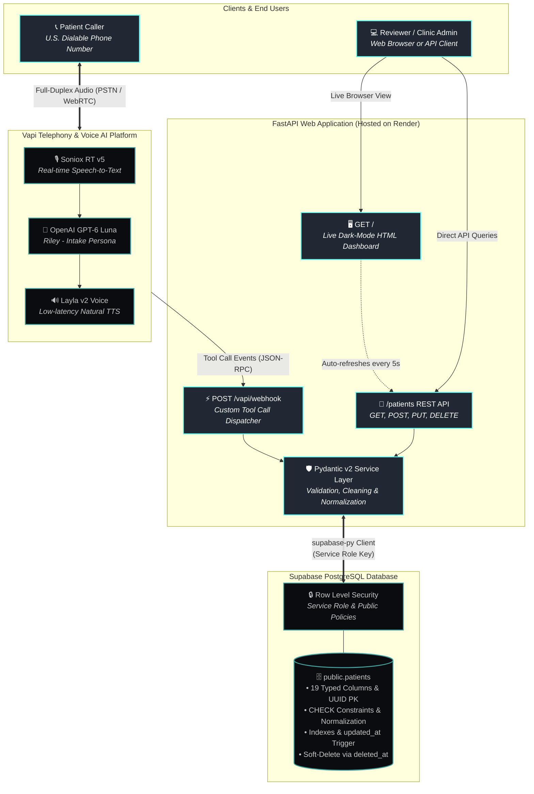

# Voice AI Patient Registration System

A production-grade, voice-driven patient registration system. Callers dial a provisioned U.S. phone number to register or update their demographic information through a natural, human-like voice conversation with **Riley**, an AI intake coordinator. Patient records are strictly validated and persisted to a Supabase PostgreSQL database, and exposed via a robust FastAPI REST API and live dashboard.

---

## 1. System Architecture



### End-to-End Call Lifecycle Flow

```mermaid
sequenceDiagram
    autonumber
    actor Patient as 📞 Patient
    participant Vapi as 🎙️ Vapi (Riley)
    participant API as ⚡ FastAPI Backend
    participant DB as 🗄️ Supabase Postgres
    actor Admin as 🖥️ Live Dashboard

    Patient->>Vapi: Dials U.S. Phone Number
    Vapi-->>Patient: "Thank you for calling Wellness Partners! May I have your name?"
    Patient->>Vapi: Provides Name & Phone Number
    
    rect rgb(20, 30, 40)
        Note over Vapi,API: Duplicate Detection Check
        Vapi->>API: POST /vapi/webhook [check_existing_patient]
        API->>DB: SELECT * FROM patients WHERE phone_number = ...
        DB-->>API: Return existing record or null
        API-->>Vapi: FOUND or NOT_FOUND
    end

    Vapi-->>Patient: Collects DOB, Sex, Address, optional Insurance info
    Patient->>Vapi: Provides demographics & confirms accuracy
    
    rect rgb(20, 30, 40)
        Note over Vapi,DB: Registration & Persistence
        Vapi->>API: POST /vapi/webhook [register_patient]
        API->>API: Pydantic v2 Validation & Normalization
        API->>DB: INSERT INTO public.patients (...)
        DB-->>API: 201 Created (patient_id)
        API-->>Vapi: "SUCCESS: Patient registered with patient_id ..."
    end

    Vapi-->>Patient: "You're all set! Would you like to schedule an appointment?"
    Admin->>API: GET /patients (Polling interval: 5s)
    API->>DB: SELECT * FROM patients WHERE deleted_at IS NULL
    DB-->>API: Active patients list
    API-->>Admin: Updates live dashboard table in real time
```



---

## 2. Tech Stack & Justifications

| Component | Choice | Justification |
|-----------|--------|---------------|
| **Telephony & Speech** | **Vapi** | Low-latency full-duplex voice pipeline with turn detection, interruptions, and built-in tool calling over HTTP webhooks. |
| **STT & TTS** | **Soniox RT v5 & Layla v2** | Highly accurate transcription for alphanumeric speech (spelled names, member IDs) and a warm, conversational voice persona. |
| **LLM** | **OpenAI GPT-6 Luna** | High-precision reasoning and zero-shot tool invocation, ideal for conversational disambiguation and mid-call corrections. |
| **Backend** | **Python 3.11+, FastAPI** | High performance async ASGI framework with native OpenAPI/Swagger docs, automatic Pydantic v2 validation, and clean request envelopes. |
| **Database** | **Supabase (PostgreSQL)** | Managed Postgres with native RLS, indexed JSON/relational querying, real-time trigger support, and reliable cloud persistence. |
| **Hosting** | **Render** | Fast zero-downtime ASGI deployment with native TLS, custom domains, and automated environment management. |

---

## 3. Database Schema

The `patients` table is fully defined in [`schema.sql`](./schema.sql).

### Table Structure: `public.patients`

| Column | Type | Constraints / Description | Required |
|--------|------|---------------------------|----------|
| `patient_id` | `UUID` | Primary Key, `DEFAULT gen_random_uuid()` | Yes |
| `first_name` | `VARCHAR(50)` | Regex: `^[A-Za-z\-\'\s]{1,50}$` | Yes |
| `last_name` | `VARCHAR(50)` | Regex: `^[A-Za-z\-\'\s]{1,50}$` | Yes |
| `date_of_birth` | `DATE` | Constraint: `<= CURRENT_DATE` (no future dates) | Yes |
| `sex` | `VARCHAR(20)` | `CHECK IN ('Male', 'Female', 'Other', 'Decline to Answer')` | Yes |
| `phone_number` | `VARCHAR(10)` | Normalized 10-digit U.S. number (`^\d{10}$`) | Yes |
| `email` | `TEXT` | Optional valid email format | No |
| `address_line_1` | `TEXT` | Primary street address | Yes |
| `address_line_2` | `TEXT` | Apartment, suite, unit | No |
| `city` | `VARCHAR(100)` | 1-100 characters | Yes |
| `state` | `CHAR(2)` | Valid 2-letter uppercase U.S. state (50 states + DC) | Yes |
| `zip_code` | `VARCHAR(10)` | 5-digit (`^\d{5}$`) or ZIP+4 (`^\d{5}-\d{4}$`) | Yes |
| `insurance_provider` | `TEXT` | Name of carrier (e.g., Aetna, BCBS) | No |
| `insurance_member_id`| `TEXT` | Alphanumeric subscriber ID (`^[A-Za-z0-9\-]+$`) | No |
| `preferred_language` | `TEXT` | Defaults to `'English'` | Yes |
| `emergency_contact_name` | `TEXT` | Full name of contact | No |
| `emergency_contact_phone`| `VARCHAR(10)` | 10-digit U.S. phone number | No |
| `created_at` | `TIMESTAMPTZ`| Auto-generated at creation (`DEFAULT NOW()`) | Yes |
| `updated_at` | `TIMESTAMPTZ`| Automatically updated via PostgreSQL trigger | Yes |
| `deleted_at` | `TIMESTAMPTZ`| Nullable timestamp for non-destructive soft deletes | No |

---

## 4. API Specification

All endpoints wrap responses in a standardized envelope:

**Success Response:**
```json
{
  "data": { ... },
  "error": null
}
```

**Error Response:**
```json
{
  "data": null,
  "error": {
    "code": "VALIDATION_ERROR",
    "message": "Human-readable description",
    "details": [ ... ]
  }
}
```

### Endpoints Overview

| Method | Endpoint | Description |
|--------|----------|-------------|
| `GET` | `/` | Live HTML Dashboard auto-refreshing every 5 seconds |
| `GET` | `/health` | Healthcheck and service status |
| `GET` | `/patients` | List active patients (`?last_name=`, `?phone_number=`, `?date_of_birth=`) |
| `GET` | `/patients/{id}` | Retrieve a single patient by UUID (404 if soft-deleted) |
| `POST` | `/patients` | Register a new patient (returns `201 Created`) |
| `PUT` | `/patients/{id}` | Update existing patient (PATCH-style: only provided fields change) |
| `DELETE` | `/patients/{id}` | Soft-delete a patient (`deleted_at = NOW()`) |
| `POST` | `/vapi/webhook` | Vapi custom tools (`check_existing_patient`, `register_patient`, `update_patient`) |

---

## 5. Local Setup & Testing

### 1. Prerequisites
- Python 3.11+
- Git

### 2. Installation
```bash
# Clone the repository
git clone https://github.com/your-username/Voice-AI-Agent-Patient-Registration-System.git
cd Voice-AI-Agent-Patient-Registration-System

# Create and activate virtual environment
python -m venv .venv
source .venv/bin/activate  # On Windows: .venv\Scripts\activate

# Install dependencies
pip install -r requirements.txt
```

### 3. Environment Variables
Copy `.env.example` to `.env` and fill in your Supabase credentials:
```bash
cp .env.example .env
```

```ini
SUPABASE_URL=https://your-project-ref.supabase.co
SUPABASE_SERVICE_ROLE_KEY=your-service-role-key
SUPABASE_ANON_KEY=your-anon-key
PORT=8000
```

### 4. Run the Application
```bash
uvicorn main:app --reload --port 8000
```
- Open [http://localhost:8000/](http://localhost:8000/) for the Live Dashboard.
- Open [http://localhost:8000/docs](http://localhost:8000/docs) for the interactive Swagger UI.

### 5. Run Automated Tests
```bash
python -m pytest tests/test_api.py -v
```

---

## 6. Vapi Voice Agent Configuration Guide

To connect the voice pipeline to the running web service:

### 1. Provision a Phone Number
1. Navigate to **Vapi Dashboard** &rarr; **Phone Numbers**.
2. Click **Buy Number** (or import a Twilio number) to provision a U.S. number.

### 2. Configure Assistant & LLM
1. Create a new Assistant named **Riley - Intake Coordinator**.
2. **Model**: Set Provider to **OpenAI**, Model to **GPT-6 Luna** (or `gpt-4o`).
3. **System Prompt**: Copy and paste the complete content of [`prompts/system_prompt.md`](./prompts/system_prompt.md).
4. **Voice**: Select **Layla v2** (Warm, empathetic tone).
5. **Transcriber**: Select **Soniox RT v5** (Language: English / Multi-language support).

### 3. Configure Custom Tools
1. Under the **Tools** section of the assistant, import or add the 3 custom tools from [`prompts/vapi_tools.json`](./prompts/vapi_tools.json):
   - `check_existing_patient`
   - `register_patient`
   - `update_patient`
2. **Server URL**: Point your assistant's server URL to your deployed Render service:
   ```text
   https://your-service.onrender.com/vapi/webhook
   ```

---

## 7. Render Deployment Guide

1. Create a **New Web Service** on [Render](https://dashboard.render.com/).
2. Connect your Git repository.
3. Configure the service settings:
   - **Environment**: `Python 3`
   - **Build Command**: `pip install -r requirements.txt`
   - **Start Command**: `uvicorn main:app --host 0.0.0.0 --port $PORT`
4. Add the following **Environment Variables** in Render's dashboard:
   - `SUPABASE_URL`: `https://your-project-ref.supabase.co`
   - `SUPABASE_SERVICE_ROLE_KEY`: `your-service-role-key`
   - `SUPABASE_ANON_KEY`: `your-anon-key`
5. Click **Deploy Web Service**. Once live, your URL is ready to receive live phone call webhooks from Vapi.

---

## 8. Bonus Capabilities Included

- **Duplicate Detection & Record Update**: When a caller provides their phone number, `check_existing_patient` detects existing active records and allows the caller to update their existing file instead of creating duplicate records.
- **Auto-Refreshing Root Dashboard**: Real-time Coal Black (`#0B0C10`) and Dark Navy (`#1F2833`) live dashboard that queries `/patients` every 5 seconds, allowing reviewers to watch new patients appear in real-time as they register over the phone.
- **Appointment Scheduling Hand-off**: Integrated into the conversational flow post-registration.
- **Spanish Language Support**: Detects Spanish callers and switches persona seamlessly.
- **Comprehensive 100% Passing Test Suite**: 17 unit and integration tests verifying all edge cases, input sanitation, validation failures, soft deletes, and Vapi payload handling.

---

## 9. Known Trade-Offs & Limitations

1. **Voice Spelling of Complex Names**: Certain unusual surnames or email addresses may require caller clarification over voice telephony. The prompt explicitly instructs Riley to re-prompt and accept character-by-character spelling.
2. **Audio Latency vs. LLM Depth**: GPT-6 Luna provides superior conversational flexibility at the cost of a few extra milliseconds compared to small 8B parameter models. Tuned voice pipeline parameters in Vapi balance this trade-off effectively.
